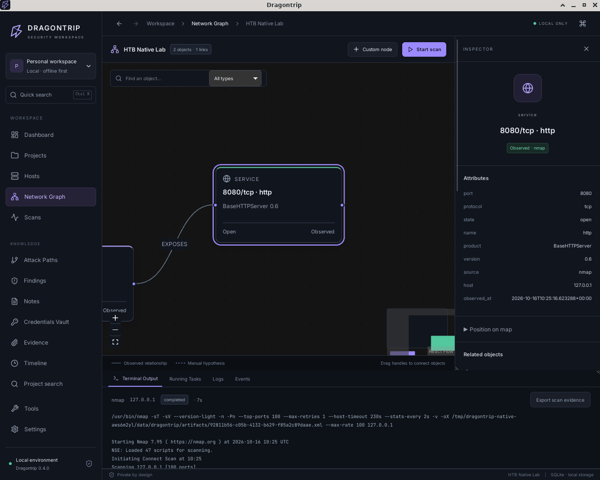
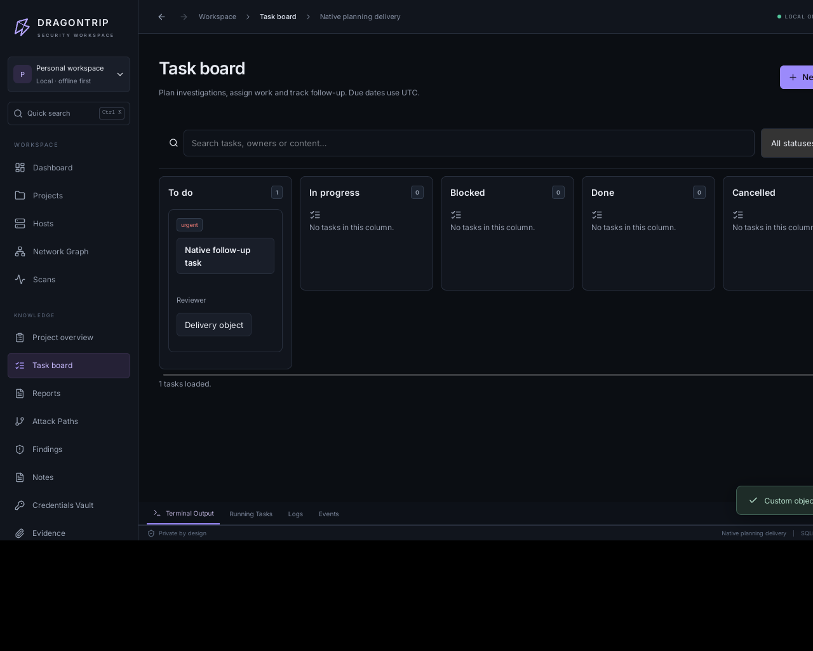

<div align="center">

# DRAGONTRIP

**Всё расследование — в одном проекте.**

Локальное настольное приложение для security assessments: разведка, граф инфраструктуры, доказательства, находки, задачи и отчёты.

[Скачать v0.5.0](https://github.com/coldvisixn/dragontrip/releases/tag/v0.5.0) · [Установка на Kali](docs/INSTALL-KALI.md) · [English](README.md) · [Документация](docs/README.md)

</div>



Dragontrip помогает вести разрешённый аудит, лабораторную работу или расследование без разрозненных файлов: результаты recon, связи между объектами, заметки, уязвимости и дальнейшие действия хранятся в одном локальном проекте.

**Версия 0.5.0 — ранняя preview-версия.** Доступен `.deb` для Linux x86_64 (`amd64`). Локальный пакет проверен в установленном Debian-приложении с WebKit. Проверки Kali Rolling CI и вашей 4 ГБ VirtualBox VM учитываются отдельно. Готовых сборок для Windows, macOS и ARM пока нет. Интерфейс приложения сейчас на английском.

## Скачать и установить

1. Откройте [релиз v0.5.0](https://github.com/coldvisixn/dragontrip/releases/tag/v0.5.0).
2. В разделе **Assets** скачайте `dragontrip_0.5.0_amd64.deb` и `dragontrip_0.5.0_amd64.deb.sha256`. Архивы **Source code** содержат исходники, а не установщик.
3. Откройте терминал в папке со скачанными файлами:

```bash
sha256sum --check dragontrip_0.5.0_amd64.deb.sha256
sudo apt update
sudo apt install ./dragontrip_0.5.0_amd64.deb
dragontrip
```

Для recon на Kali установите нужные инструменты:

```bash
sudo apt install nmap whatweb httpx-toolkit ffuf
```

Node.js, Rust, pip и Docker для запуска готового пакета не нужны. Python-бэкенд включён в пакет. Сканеры запускаются из системы; нужен **ProjectDiscovery httpx**, а не одноимённая Python-библиотека.

[Подробная установка, обновление и решение проблем →](docs/INSTALL-KALI.md)

## Возможности

- **Recon:** Nmap, WhatWeb, ProjectDiscovery httpx, ffuf; профили Quick/Full/Service, очередь, отмена и история сканирований.
- **Граф инфраструктуры:** хосты, сервисы, URL, собственные объекты и связи; Inspector, поиск, сохранение координат и положения карты.
- **Знания:** Markdown-заметки, находки с критичностью, статусом и remediation; упорядоченные ручные планы расследования.
- **Доказательства:** скриншоты и файлы, оригинальные XML/JSON-артефакты, SHA-256, Timeline и общий поиск.
- **Задачи:** пять статусов, приоритеты, ответственные, сроки, шаблоны и связи с объектами; сводка прогресса и рисков проекта.
- **Отчёты:** выбор разделов и фильтров находок, executive summary, предпросмотр и экспорт Markdown.
- **Credentials Vault:** отдельное шифрование секретов, мастер-пароль, показ/скрытие, блокировка и истечение неактивной сессии.
- **Перенос проектов:** `.dtproj` с графом, знаниями и evidence; credentials включаются только явно, с отдельным паролем архива.
- **Настройки:** тема, акцент, плотность интерфейса, детализация графа и пути к инструментам. `Ctrl+K` открывает палитру команд.



На скриншотах показаны тестовые проекты. В новые проекты демонстрационные находки не добавляются.

## Локальные данные

Проекты находятся в `${XDG_DATA_HOME:-~/.local/share}/dragontrip/`. Приложение использует SQLite, локальные файлы и API на loopback с отдельным токеном на каждый запуск. Облачная база и аккаунт Dragontrip не нужны.

Обычные заметки, evidence и экспорты не зашифрованы. Vault шифрует именно credentials, а не весь проект. Сканеры отправляют сетевые запросы к разрешённым вами целям. Используйте приложение только в пределах полученного разрешения.

Перед обновлением закройте приложение и сохраните копию всей папки данных. Удаление `.deb` не удаляет проекты. [Данные и резервные копии →](docs/DATA.md)

## Ограничения

Сейчас поддерживаются отдельные IPv4-адреса и IPv4 web origins в зависимости от инструмента. Домены, CIDR и IPv6 в scope пока не поддерживаются. Произвольного запуска shell-команд и автоматической эксплуатации нет; Attack Paths и задачи — ручные планы. Отчёты экспортируются в Markdown; PDF/HTML пока нет. Настройки составляемого отчёта сбрасываются при выходе со страницы. Хвост терминального вывода ограничен, очистка артефактов выполняется вручную.

Проекты с задачами 0.5.0 требуют обновлённого импортера. Проверка на вашей Kali/VirtualBox остаётся важной частью оценки производительности; измерения из облачного Debian-контейнера приведены отдельно.

## Для разработчиков

**Tauri 2 · React/TypeScript · Python/FastAPI · SQLite**

[Сборка и разработка](docs/DEVELOPMENT.md) · [Как внести вклад](CONTRIBUTING.md) · [История изменений](CHANGELOG.md) · [Roadmap](docs/ROADMAP.md) · [Проверка сборки 0.5.0](docs/BUILD-0.5.0.md)

Лицензия — [MIT](LICENSE). Системные recon-инструменты распространяются по своим лицензиям.
