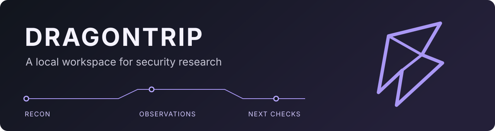
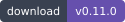
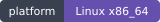
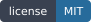
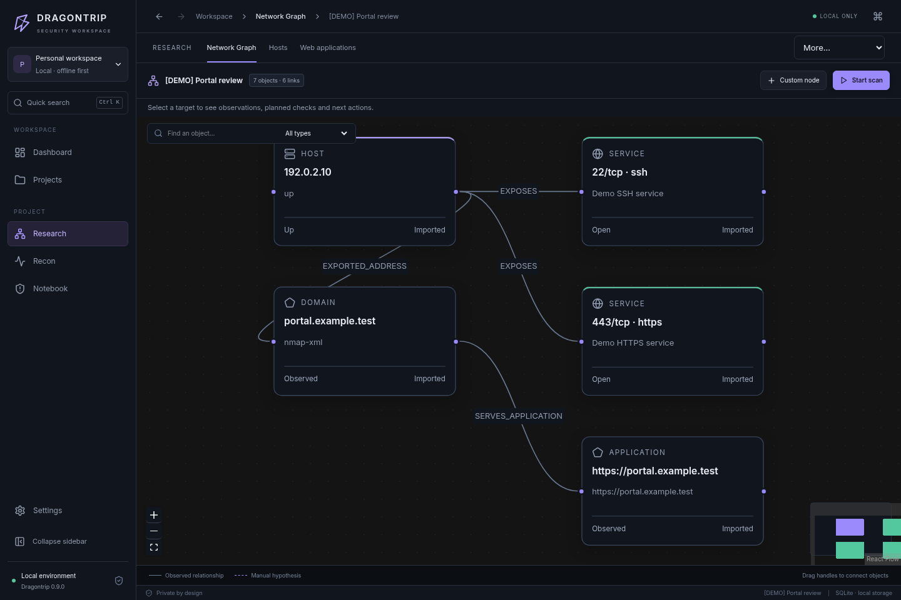
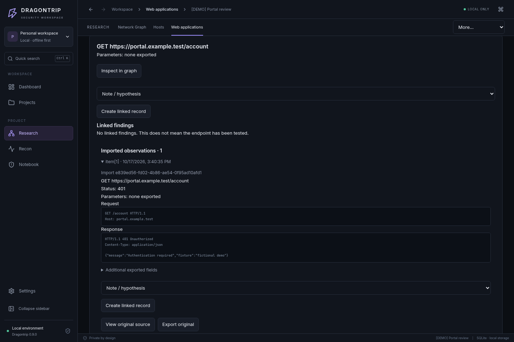
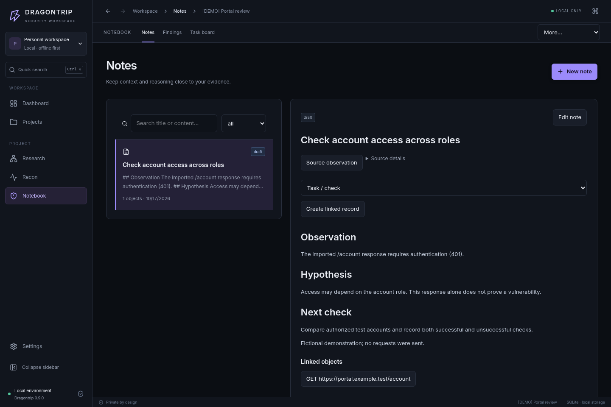

<div align="center">



# Следуйте за доказательствами. Сохраняйте нить исследования.

**Локальное desktop-приложение для пентеста и исследования безопасности.**

Объединяйте результаты разведки, наблюдения, гипотезы, находки и следующие проверки в одном проекте — и возвращайтесь к сохранённому ходу рассуждений.

**[Скачать для Linux · v0.9.0](https://github.com/coldvisixn/dragontrip/releases/tag/v0.9.0)** · [Быстрый старт](#быстрый-старт) · [Посмотреть в работе](docs/SHOWCASE.md) · [English](README.md)

[](https://github.com/coldvisixn/dragontrip/releases/tag/v0.9.0)
[](https://github.com/coldvisixn/dragontrip/actions/workflows/linux.yml)
[](docs/INSTALL-KALI.md)
[](LICENSE)

</div>



## Сохраняйте исследование целиком

После проверки остаётся больше, чем вывод сканера: интересный ответ сервера, неподтвердившаяся гипотеза, незаконченная заметка, находка с доказательствами. Dragontrip связывает эти части с источниками и дальнейшей работой.

Для практикующих пентестеров, независимых исследователей безопасности и тех, кто учится в авторизованных лабораториях.

- **Возвращайтесь к источнику.** Импортируйте результаты Nmap, Burp и Nuclei; переходите от инфраструктуры и web-endpoint к наблюдениям и исходным файлам.
- **Превращайте наблюдения в работу.** Создавайте связанную заметку, гипотезу, черновик находки или задачу. Сохраняйте и неудачные проверки.
- **Продолжайте с контекстом.** Восстанавливайте страницу проекта, выбранные объекты, фильтры и черновики. Сравнивайте обе версии при конфликте и возвращайте заменённый текст.
- **Храните рабочее пространство локально.** SQLite и файлы доказательств находятся на вашем компьютере. Аккаунт Dragontrip и облачная база проектов не нужны.

## От разведки к следующей проверке

1. **Задайте границы.** Укажите включённые и исключённые цели. Импортируйте готовые результаты с предпросмотром или подтвердите live recon через поддерживаемые профили инструментов.
2. **Изучите наблюдения.** Переходите между хостами, сервисами и приложениями в графе; исследуйте endpoint с конкретным HTTP-методом и исходные наблюдения.
3. **Сформулируйте гипотезу.** Создайте связанную запись, соберите доказательства и определите ручную проверку. Само импортированное наблюдение ещё не подтверждает уязвимость.
4. **Проверьте и зафиксируйте.** Ведите задачи, ручные решения по методологии и ретесты находок. После полного предпросмотра и подтверждения последовательность recon может переходить к следующим шагам автоматически; доступны пауза, отмена и явный повтор.
5. **Продолжите или поделитесь.** Откройте проект с сохранённым контекстом, перенесите его через `.dtproj` или экспортируйте выбранные материалы в Markdown, самостоятельный HTML либо ZIP с доказательствами.

Отчёт — один из возможных результатов. Полезная следующая проверка, опровергнутая гипотеза и сохранённый исследовательский блокнот тоже имеют ценность.

## Сценарии применения

- **Авторизованный пентест:** объедините инвентаризацию сервисов Nmap, наблюдения endpoint из Burp и HTTP-результаты Nuclei. Свяжите предполагаемую проблему контроля доступа с источником, запланируйте ручную проверку и сохраните результат перед подтверждением находки.
- **Самостоятельное исследование:** держите вместе гипотезу, исходные ответы и проверки, которые её опровергли; возвращайтесь к работе без восстановления истории по терминальным логам.
- **Лаборатория или обучение:** исследуйте HTB-машину или похожую авторизованную цель, сохраняйте ход решения между сессиями и ведите собственные заметки по методологии.

## Посмотрите сценарий

**[Короткая запись работы](docs/SHOWCASE.md#recorded-walkthrough)** · [Полная галерея, включая светлую тему](docs/SHOWCASE.md)

<details>
<summary><strong>Endpoint и исходное наблюдение</strong></summary>



</details>

<details>
<summary><strong>Гипотеза, её источник и дальнейшая работа</strong></summary>



</details>

Скриншоты и запись показывают настоящее приложение с отдельным, явно подготовленным вымышленным проектом (`192.0.2.10`, `portal.example.test`). Запросы к целям не отправлялись. Новые проекты создаются пустыми; встроенный демопроект добавляется отдельно по вашему выбору.

## Быстрый старт

Скачайте **[`dragontrip_0.9.0_amd64.deb`](https://github.com/coldvisixn/dragontrip/releases/download/v0.9.0/dragontrip_0.9.0_amd64.deb)** и **[файл SHA-256](https://github.com/coldvisixn/dragontrip/releases/download/v0.9.0/dragontrip_0.9.0_amd64.deb.sha256)** в одну папку. Архивы GitHub «Source code» предназначены для разработчиков.

```bash
sha256sum --check dragontrip_0.9.0_amd64.deb.sha256
sudo apt update
sudo apt install ./dragontrip_0.9.0_amd64.deb
dragontrip
```

Создайте проект, выберите **Import results**, проверьте предпросмотр поддерживаемого экспорта и откройте **Research**. Чтобы познакомиться с приложением без собственных данных, нажмите **Create fictional demo** на Dashboard или Projects. [Первый проект →](docs/USAGE.md)

Для live recon на Kali установите нужные инструменты:

```bash
sudo apt install nmap whatweb httpx-toolkit ffuf
```

В `.deb` включены интерфейс и Python-бэкенд; Node.js, Rust, pip и Docker для запуска не нужны. Recon-инструменты устанавливаются отдельно в систему. Адаптеру httpx нужен **ProjectDiscovery httpx** (`httpx-toolkit` на Kali), а не одноимённая Python-библиотека.

**Текущий пакет:** 0.9.0 — prerelease (ранний MVP), с английским интерфейсом и установщиком для Linux x86_64. Проверки опубликованного пакета на Debian и установленного приложения на Kali описаны в [результатах верификации](docs/BUILD-0.9.0.md); проверка настоящей 4 ГБ VirtualBox VM остаётся отдельной. [Установка, обновление и решение проблем →](docs/INSTALL-KALI.md) · [English installation guide →](docs/INSTALL.md)

## Возможности и границы

Также доступны ручные методологии проверки, граф инфраструктуры, файлы доказательств и история источников, доска задач, зашифрованное хранилище credentials, перенос проектов и настраиваемые отчёты. [Подробные возможности и ограничения →](docs/CAPABILITIES.md) · [Изменения в 0.9.0 →](docs/releases/v0.9.0.md)

- Live recon использует **Nmap, WhatWeb, ProjectDiscovery httpx и ffuf** с отдельными IPv4-адресами либо IPv4 web origins в зависимости от адаптера. Offline-поддержка доменов/CIDR/IPv6 не означает их поддержку при live-сканировании.
- Импортируются определённые XML-экспорты Nmap/Burp и HTTP Nuclei JSONL. Встроенного запуска Nuclei, произвольных shell-команд и автоматической эксплуатации нет.
- Обычные данные проекта **не зашифрованы**. Vault отдельно шифрует credentials. Исследовательские черновики и сохранённые версии текста входят в `.dtproj` v5; проверьте их перед передачей. Состав отчёта остаётся локальным. [Хранение, резервные копии и восстановление →](docs/DATA.md)
- Отчёты экспортируются в Markdown, HTML или ZIP с явно выбранными доказательствами (100 файлов / 32 MiB); встроенного PDF/DOCX-экспорта нет. Установщики для Windows, macOS и ARM не предоставляются.

Используйте Dragontrip только в пределах полученного разрешения на тестирование. Recon отправляет трафик к подтверждённым вами целям; методологии и планы исследования документируют ручную работу. [Политика безопасности →](SECURITY.md)

## Документация и участие

[Документация](docs/README.md) · [Руководство пользователя](docs/USAGE.md) · [Импорт](docs/IMPORTS.md) · [Последовательности recon](docs/METHODOLOGIES.md) · [Черновики и восстановление](docs/HTB-WORKSPACE.md) · [История изменений](CHANGELOG.md) · [Roadmap](docs/ROADMAP.md)

Стек: **Tauri 2 · React/TypeScript · Python/FastAPI · SQLite**.

Для сборки из исходников установите [зависимости разработки и закреплённые версии инструментов](docs/DEVELOPMENT.md), затем:

```bash
git clone https://github.com/coldvisixn/dragontrip.git
cd dragontrip
bash scripts/setup.sh
npm run desktop:dev
```

Приветствуются [изменения в проект](CONTRIBUTING.md), [воспроизводимые сообщения об ошибках](https://github.com/coldvisixn/dragontrip/issues/new/choose) и обратная связь об удобстве работы. Используйте вымышленные или обезличенные данные. Об уязвимостях реализации сообщайте по [SECURITY.md](SECURITY.md).

Лицензия — [MIT](LICENSE). Отдельно установленные recon-инструменты сохраняют свои лицензии.
