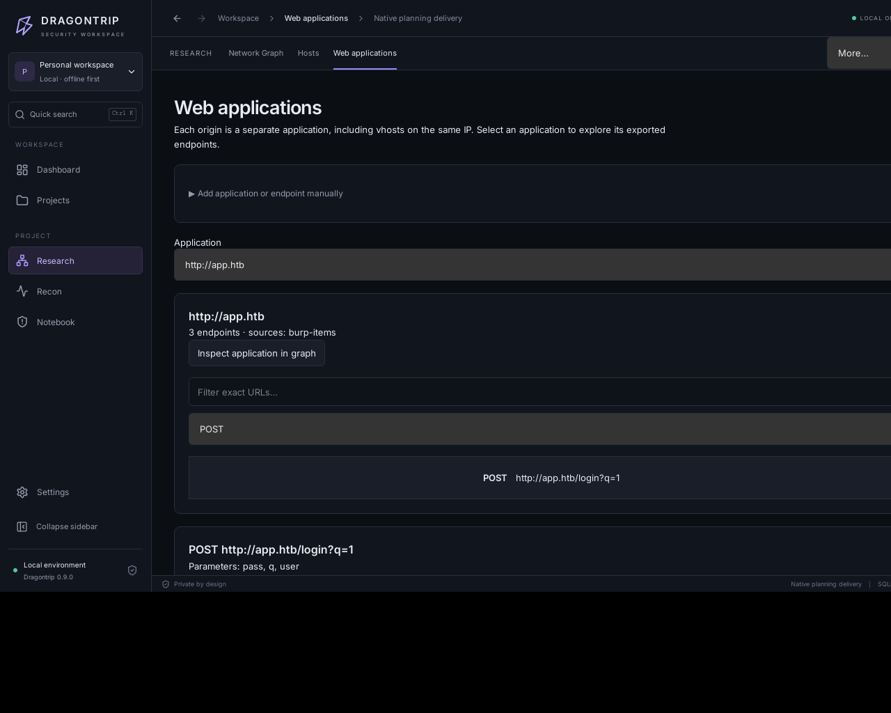
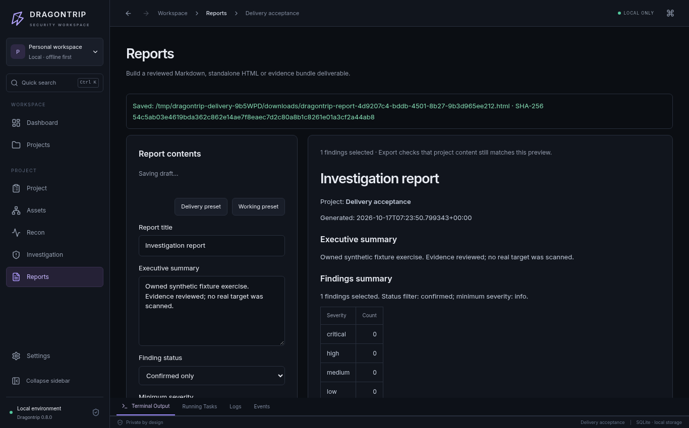

<div align="center">

# DRAGONTRIP

**Исследуй машину. Сохраняй ход решения. Продолжай с того же места.**

Локальное desktop-приложение для Hack The Box и похожих авторизованных лабораторий: результаты Nmap, Burp и Nuclei, наблюдения, гипотезы, находки и следующие проверки в одном проекте. Без аккаунта Dragontrip.

[Скачать v0.9.0](https://github.com/coldvisixn/dragontrip/releases/tag/v0.9.0) · [Установка на Kali](docs/INSTALL-KALI.md) · [English](README.md) · [Документация](docs/README.md)

</div>



Dragontrip помогает пентестерам и исследователям пройти путь от вывода инструментов до находок с проверяемыми доказательствами. Инфраструктура, web-приложения, заметки, чек-листы и дальнейшие действия остаются в одном проекте на вашем компьютере.

**0.9.0 · Ранний MVP · Linux x86_64 · MIT.** Установщик `.deb` и его контрольная сумма доступны в релизе по ссылке выше. Интерфейс на английском. [Что изменилось](docs/releases/v0.9.0.md) · [Сценарий работы и ограничения](docs/DELIVERY.md).

## Что нового в 0.9.0

- **Продолжайте с того же места:** восстанавливаются страница, вкладка, объект, приложение/endpoint, поиск, фильтры, граф и открытый черновик — отдельно для каждого проекта.
- **Разрешайте конфликты:** обе версии с временем изменения, сохранение отдельной записи, ручное объединение и восстановление заменённого текста. Статус показывает, где сохранена работа.
- **Пишите прямо из наблюдения:** заметка/гипотеза, черновик находки или задача получают объект, источник, запуск и доказательства. Повторные нажатия и импорты не плодят записи.
- **Выполняйте выбранные проверки:** общий предпросмотр последовательности, автоматический следующий шаг, пауза, отмена и повтор с историей. Перезапуск не возобновляет сетевые действия.
- **Меньше лишнего:** Research, Recon и Notebook, контекстные действия и скрытые дополнительные поля. Методологии, vault, ручные ретесты и отчёты остаются доступны.

## Один проект: от первого импорта до передачи результата

1. **Задайте границы.** Укажите включённые и исключённые IP, сети, домены и web origins.
2. **Загрузите результаты.** Проверьте предпросмотр Nmap XML, Burp saved-items/issue XML или HTTP Nuclei JSONL. Сохраните исходники и сравните, что добавилось или изменилось.
3. **Проследите связи.** Переходите от графа инфраструктуры к web-приложениям, endpoint с конкретным HTTP-методом и исходным наблюдениям.
4. **Оформите находки.** Свяжите их с объектами, заметками и evidence. Отметьте выполненные проверки методологии, создайте задачи для дальнейшей работы.
5. **Передайте результат.** Соберите Markdown-отчёт или перенесите проект с доказательствами через архив `.dtproj`.

Для live recon доступны Nmap, WhatWeb, ProjectDiscovery httpx и ffuf: проверяемые профили, очередь и отмена. Сохранённые последовательности показывают scope и параметры; после подтверждения можно выполнить выбранные шаги целиком или по одному. [Форматы импорта и ограничения](docs/IMPORTS.md) · [Методологии и последовательности recon](docs/METHODOLOGIES.md).

## Скачать и установить

1. Откройте [релиз v0.9.0](https://github.com/coldvisixn/dragontrip/releases/tag/v0.9.0).
2. В разделе **Assets** скачайте `dragontrip_0.9.0_amd64.deb` и `dragontrip_0.9.0_amd64.deb.sha256`. Архивы **Source code** содержат исходники, а не установщик.
3. Откройте терминал в папке со скачанными файлами:

```bash
sha256sum --check dragontrip_0.9.0_amd64.deb.sha256
sudo apt update
sudo apt install ./dragontrip_0.9.0_amd64.deb
dragontrip
```

Для recon на Kali установите нужные инструменты:

```bash
sudo apt install nmap whatweb httpx-toolkit ffuf
```

Node.js, Rust, pip и Docker для запуска готового пакета не нужны. Python-бэкенд включён в пакет. Сканеры запускаются из системы; нужен **ProjectDiscovery httpx**, а не одноимённая Python-библиотека.

[Подробная установка, обновление и решение проблем →](docs/INSTALL-KALI.md)

## Возможности

- **Scope и импорт:** правила включения/исключения, предпросмотр Nmap/Burp/Nuclei, сохранение исходников, сравнение импортов и карта web-приложений/endpoint.
- **Recon:** Nmap, WhatWeb, ProjectDiscovery httpx, ffuf; профили Quick/Full/Service, очередь, отмена и история сканирований.
- **Граф инфраструктуры:** хосты, сервисы, URL, собственные объекты и связи; Inspector, поиск, сохранение координат и положения карты.
- **Знания:** Markdown-заметки, находки с критичностью, статусом, remediation и историей ретестов; шаблон находки, восстановление черновиков и ручные планы расследования.
- **Доказательства:** загрузка, вставка и перетаскивание скриншотов/файлов, оригинальные XML/JSON-артефакты, SHA-256, Timeline и общий поиск.
- **Методологии и workflow:** четыре состояния ручной проверки web/service; сохранённые последовательности recon с предпросмотром scope и явным запуском каждого шага.
- **Задачи:** пять статусов, приоритеты, ответственные, сроки, шаблоны и связи с объектами; сводка прогресса и рисков проекта.
- **Отчёты:** сохранение состава и summary, рабочий пресет и пресет для передачи, проверка предпросмотра; экспорт Markdown, HTML или ZIP с выбранными доказательствами.
- **Credentials Vault:** отдельное шифрование секретов, мастер-пароль, показ/скрытие, блокировка и истечение неактивной сессии.
- **Перенос проектов:** `.dtproj` с графом, знаниями и evidence; credentials включаются только явно, с отдельным паролем архива.
- **Настройки:** тема, акцент, плотность интерфейса, детализация графа и пути к инструментам. `Ctrl+K` открывает палитру команд.



На скриншотах — изолированные тестовые проекты с явно подготовленными данными. Реальные проекты создаются пустыми; демонстрационный пример добавляется отдельно и только по нажатию кнопки.

## Локальные данные

Проекты находятся в `${XDG_DATA_HOME:-~/.local/share}/dragontrip/`. Приложение использует SQLite, локальные файлы и API на loopback с отдельным токеном на каждый запуск. Облачная база и аккаунт Dragontrip не нужны.

Обычные заметки, evidence и экспорты не зашифрованы. Vault шифрует именно credentials, а не весь проект. Сканеры отправляют сетевые запросы к разрешённым вами целям. Используйте приложение только в пределах полученного разрешения.

Перед обновлением закройте приложение и сохраните копию всей папки данных. Удаление `.deb` не удаляет проекты. [Данные и резервные копии →](docs/DATA.md)

## Ограничения

- Live recon принимает отдельные IPv4-адреса и IPv4 web origins в зависимости от инструмента. Offline scope и импорт также поддерживают домены, CIDR и IPv6; live-сканирование этих целей пока не реализовано.
- Поддерживаются определённые XML-экспорты Nmap/Burp и HTTP Nuclei JSONL. Бинарные `.burp`, HAR и Nessus не импортируются. Встроенного запуска Nuclei нет.
- Последовательности recon требуют явного запуска шагов. Attack Paths и задачи описывают ручные планы; автоматической эксплуатации нет.
- Отчёты экспортируются в Markdown, HTML или ZIP. Встроенного PDF/DOCX нет; HTML можно распечатать через браузер. Включение файлов — только явное, до 100 файлов / 32 MiB.
- Черновики не зашифрованы и не входят в переносимые проекты `.dtproj`. Перед переносом сохраните записи. Хвост терминального вывода ограничен, очистка артефактов выполняется вручную.
- Новые `.dtproj` используют формат v5, читаются старые v1/v2/v3/v4. Старое приложение не прочитает v5. Перед обновлением нужна резервная копия; для отката — соответствующая копия базы.

Опубликованный `.deb` 0.9.0 прошёл [release workflow](https://github.com/coldvisixn/dragontrip/actions/runs/39024772755), независимую проверку скачанного файла/SHA-256 и проверку установленного Debian-приложения Tauri/WebKit с перезапуском и восстановлением. [Kali Rolling acceptance](https://github.com/coldvisixn/dragontrip/actions/runs/39041521955/job/117422788256) прошла на отдельной CI-сборке с тем же кодом приложения. [Точные результаты и ограничения](docs/BUILD-0.9.0.md). Проверка вашей 4 ГБ VirtualBox VM остаётся отдельной. Пакетов для Windows, macOS и ARM нет.

## Для разработчиков

**Tauri 2 · React/TypeScript · Python/FastAPI · SQLite**

[Сборка и разработка](docs/DEVELOPMENT.md) · [Как внести вклад](CONTRIBUTING.md) · [История изменений](CHANGELOG.md) · [Roadmap](docs/ROADMAP.md) · [Проверка сборки 0.9.0](docs/BUILD-0.9.0.md)

Лицензия — [MIT](LICENSE). Системные recon-инструменты распространяются по своим лицензиям.

В текущем исходном коде: [локальное исследование HTB-машин](docs/HTB-WORKSPACE.md) — черновики с разрешением конфликтов, восстановление контекста проекта, записи из наблюдений и последовательности recon с паузой и повтором. Архивы используют формат v5 с чтением v1–v4.
