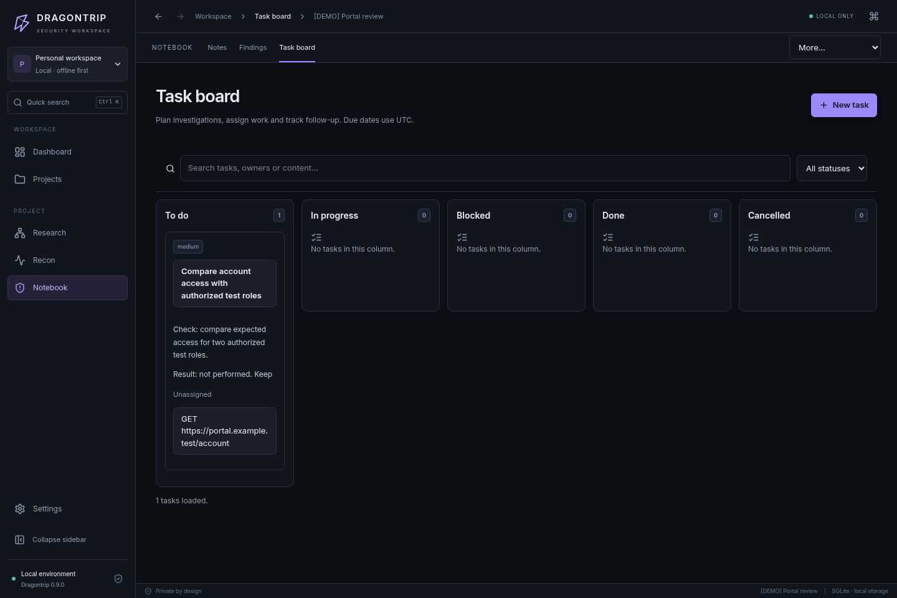
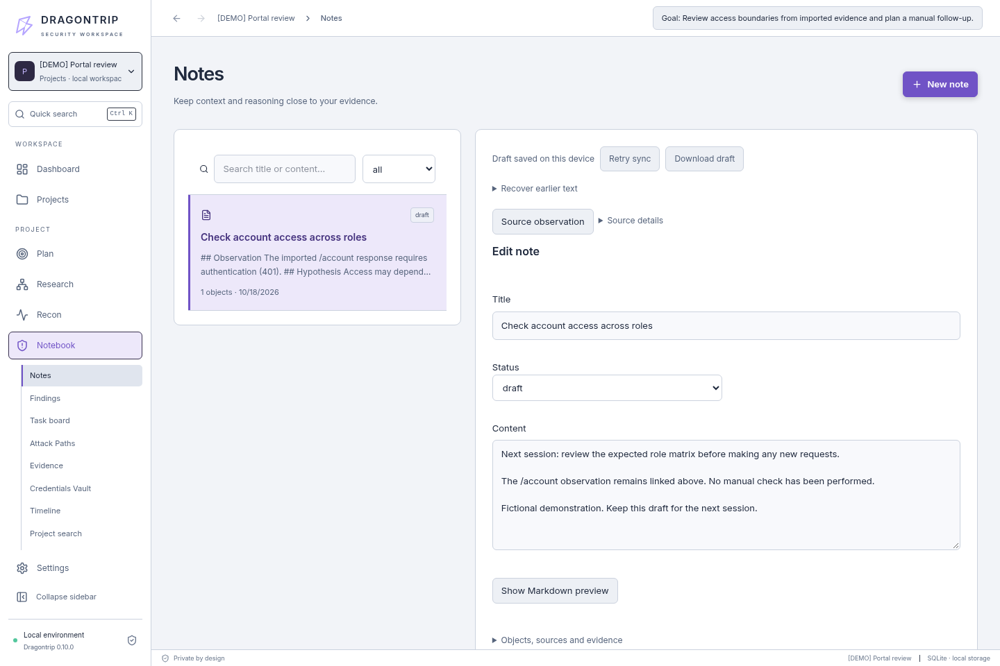

# Follow an investigation in Dragontrip

[English overview](../README.md) · [Описание на русском](../README.ru.md) · [Install](INSTALL.md) · [Capabilities](CAPABILITIES.md)

This gallery follows an observation into a hypothesis, a next check and a retained draft. It shows the actual 0.9.0 application UI, driven against the local Python API in an isolated browser capture. The 0.9.1 security/maintenance release preserves these workflows. Installed-app verification for the current package is documented [separately](BUILD-0.9.1.md).

All data is explicitly authored fiction: `[DEMO] Portal review`, the RFC 5737 address `192.0.2.10` and the reserved name `portal.example.test`. The Nmap/Burp-shaped files are offline fixtures, not claims of scanner results. No scanner or target request ran, no scope authorization was added and no vulnerability was confirmed. New projects start empty.

## Recorded walkthrough

[Watch or download the short recording (MP4)](media/investigation.mp4).

The recording follows real UI actions: open imported infrastructure → inspect an endpoint's 401 response → create a linked hypothesis → save a follow-up task → leave and recover a draft. It has no audio. Text entry is automated; the screen content and source links come from the application. The final task remains unperformed, and the hypothesis explicitly says that a 401 response alone does not prove a vulnerability.

## 1. Explore the imported infrastructure

Hosts, services, the application and its source observations belong to the same project. The overview keeps individual endpoints in the web application view.

## 2. Inspect an endpoint's original observation

The imported `/account` response is 401. Review its request and response, follow the original source or create a linked record. An observation remains distinct from a verified finding.

## 3. Keep a hypothesis connected to its source

Save what you observed, what it might mean and what to check next. Source links return to the imported observation; the linked-record action can prepare a follow-up task.

## 4. Plan the next check

The task carries the source hypothesis and evidence links. No result is invented: the demonstration records that the check has not been performed.

## 5. Resume a draft — light theme

Leave the editor and return to its retained text. Draft status indicates storage on the current device; [recovery and conflict handling](HTB-WORKSPACE.md#drafts-conflicts-and-recovery) explains the limits.

[Dark-theme draft view](media/draft-recovery.png).

[Capture sources, fixtures and reproduction instructions](media/README.md)
