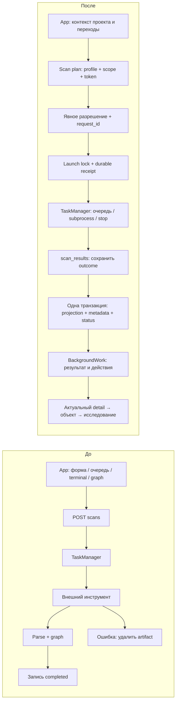
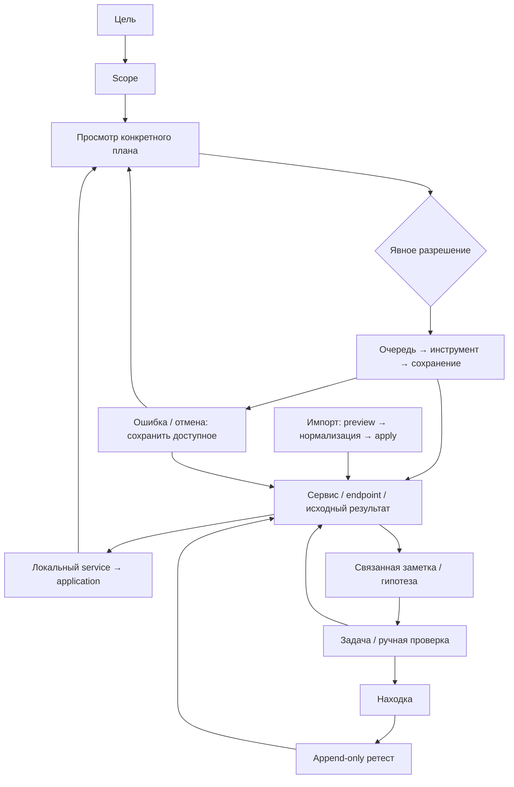

# Контракты, процессы и сохранность данных

## Границы ответственности

`App` владеет навигацией и активным контекстом, а не истинностью задания. `BackgroundWork` отвечает за представление результата. Backend владеет проверкой профиля/scope, очередью, жизненным циклом subprocess и финальным состоянием. `scan_results.py` отделяет сохранение результата от запуска инструмента. `journey.py` строит небольшую read model следующего решения из существующих сущностей; ничего не запускает. Существующие `methodologies`, `workspace`, `archives`, `evidence` сохраняют свои границы.

Синхронная SQLite-транзакция сохраняет проекцию и финальный статус вместе. Во время неё нет `await`, поэтому отмена не разрезает сохранение графа и статуса. Сам внешний файл не является частью SQL-транзакции; при аварии он остаётся исходным доказательством, а запуск помечается interrupted. Повторная проекция после аварии автоматически не выполняется.

## Основные процессы

| Процесс | Вход и условия | Владелец / создаваемые данные | Завершение, ошибка, повтор |
|---|---|---|---|
| Цель → обнаружение | Project, goal, scope; поддерживаемый target, профиль, установленный tool, явное разрешение | Project.goal; ScopeRule; Scan и artifact; backend | completed только после записи результата; отмена прекращает процесс; новая попытка через новый план |
| Сервис → web | Объект этого проекта с HTTP/HTTPS-контекстом | `/web-context`: application + RESEARCH_CONTEXT edge, существующий endpoint сохраняется | Локальный идемпотентный переход без DNS/HTTP; неподдерживаемый сервис 422, чужой объект 404; запрос к origin отдельно разрешается |
| Импорт → исследование | Файл поддерживаемого формата, preview, scope-решение | ImportRun, исходное attachment, Observations, устойчивые IDs объектов; imports backend | Apply завершён после фиксации; повтор не размножает наблюдения; UI открывает нужный тип результата |
| Наблюдение → гипотеза → задача | Существующий source проекта | Knowledge со source, node/scan/observation/attachment references; workspace backend | Повтор создания того же типа открывает существующую запись; задача сохраняет явный результат; Source links возвращают к исследованию |
| Находка → ретест | Сохранённая finding и актуальный expected_updated | Append-only content.retests; finding status | fixed → resolved, still_present → confirmed, inconclusive сохраняет прежний статус; устаревшая запись отклоняется |
| Workflow | Сохранённая definition/run, preview точных действий, явное разрешение | workflow_run и scan_ids; methodologies backend | Только разрешённые шаги; успешные этапы сохранены при сбое следующего; pause останавливает продвижение, stop также отменяет текущий scan; после рестарта paused |
| Экспорт → импорт проекта | Завершённые/остановленные задания; архив допустимого размера; пароль при переносе Vault | Новый Project; remap ID и ссылок; archives backend | Исторические задания не запускаются; повреждённый архив отклоняется с откатом; импорт намеренно создаёт отдельную копию |

## Изменения API

- `Project.goal`: отдельная цель (до 2000 символов). Старый PUT без goal не стирает её. `PUT /projects/{id}/goal` принимает `goal`, `expected_goal`: устаревшее изменение получает 409; повтор того же значения успешен. Полный legacy PUT проекта сохраняет прежнюю семантику и не приобретает CAS автоматически.
- `GET /projects/{id}/overview`: добавлен `journey` (stage/page/label/reason/included_targets/has_records). Проектный detail включает scope_targets и background_active, чтобы polling не прекращался между шагами последовательности.
- `POST /projects/{id}/scan-plan`: нормализованные параметры, target, scope, requires_confirmation, preview_token. Read-only, subprocess не создаётся.
- `POST /projects/{id}/scans`: необязательные `request_id`, `preview_token` для совместимости старого API. Новый UI использует оба. Повтор request_id и одинакового тела возвращает тот же Scan; другое тело — 409. Изменение плана/scope до запуска требует повторного просмотра и разрешения. Старые клиенты без request_id не получают гарантию идемпотентности.
- `Scan.options.stage/result`: стадия, partial, artifact_available, counts, node_ids (до 100 для перехода), projection_error. Полный граф доступен обычным API. Это JSON существующего Scan, отдельная миграция для metadata не требуется.
- `POST /scans/{id}/cancel`: возвращает фактический `cancelled` и `scan`; неизвестный ID — 404. Уже завершённое задание не объявляется отменённым.
- Artifact доступен также у failed/cancelled/interrupted, когда файл существует и укладывается в лимит; активный файл не выдаётся как готовое доказательство.

Receipt хранится в SQLite и переживает перезапуск. Launch lock действует в одном backend-процессе — это существующая архитектура desktop-приложения, не распределённая очередь. После commit и до enqueue возможна авария: при следующем старте запись становится interrupted, скрытого исполнения нет. Повтор receipt возвращает её; новая попытка требует нового разрешения. Для многошагового workflow остаётся его существующий контроль по run/step, без второго универсального движка.

## Ошибки, отмена, восстановление

| Событие | Фактическое поведение | Что видит / делает пользователь |
|---|---|---|
| Задание queued | Сохранено, ожидает слот | Можно работать в других экранах или отменить |
| running / saving | Процесс запущен / записывается итог | Стадия без выдуманного процента |
| completed | Проекция и metadata зафиксированы | Open saved results, исходное доказательство, связанная запись |
| Ненулевой exit, timeout, отмена | Процесс завершён, доступный bounded artifact сохранён | Ошибка рядом с результатом; partial явно помечен; Review new attempt |
| Неполный Nmap XML | Проецируются только полностью закрытые host; частичное покрытие не закрывает прежние сервисы | Сохранённые объекты доступны, полнота не утверждается |
| Неполный httpx JSONL | Сохранены полные строки; оборванная последняя не проецируется | Доступен частичный результат и исходный файл |
| Оборванный WhatWeb/ffuf JSON | Нельзя безопасно восстановить структуру | Исходный файл и projection_error; без выдуманных объектов |
| Сбой самой проекции | Транзакция объектов откатывается, сохраняется терминальная ошибка и доступность файла | Можно экспортировать исходное доказательство и повторить после исправления причины |
| Аварийное завершение приложения | queued/running → interrupted, workflow → paused | Никакого автоматического сетевого продолжения; новый план для повтора |
| Потерянный ответ запуска | Тот же receipt возвращает сохранённое задание | Повтор запроса не означает второй запуск |
| Переключение проекта / поздний ответ | UI проверяет проект, поколение и последовательность запросов | Старый ответ не подменяет активный detail; локальный контекст раздельный |
| Конкурирующее редактирование цели | CAS 409, локальный черновик сохраняется | Обновить серверное значение, сопоставить и явно сохранить |

Максимальный artifact — 16 MiB; превышающий лимит файл удаляется, остаётся ограниченный console tail. Console имеет существующий лимит 8 MiB за исполнение и хвост 64 KiB. «Частичный результат сохранён» не означает сохранение всех байтов неограниченного вывода. Повтор — новый запуск с начала, не продолжение subprocess с произвольного места. Pause workflow допускает завершение текущего инструмента; Stop scan действительно останавливает процессную группу.

## Миграция и совместимость

Миграция `0006_project_goal` добавляет `projects.goal` с пустым default; имя, описание и существующие связи не преобразуются в цель. Старый проект можно исследовать без обязательного заполнения нового поля. При downgrade столбец цели теряется: для отката приложения нужна соответствующая резервная копия базы.

Архив **v6** сохраняет goal и bounded terminal artifacts, включая частичные. Чтение **v1–v6** сохраняется. Старое приложение, поддерживающее максимум v5, отвергает v6; не следует вручную менять номер manifest. Импорт remap-ит node IDs в result metadata, source references, evidence и retest history; исторические статусы не возобновляют задания. Vault переносится только существующим защищённым механизмом. Черновики/сохранённый текст входят в перенос; отчётная композиция остаётся локальной.

В исходной копии именованных Low / Medium / High не было: добавлено глобальное preference `performance_profile`, default medium сохраняет прежнее поведение. Low: auto compact после 100 объектов, без minimap/фона, прямые линии, reduced motion. Medium: auto compact после 300; High — после 500. Ручной full/compact переопределяет auto; во всех профилях minimap отключается выше 500 объектов. Отдельный reduced motion, виртуализация списков/графа и vendored GLib/WebKitGTK compatibility patch сохранены. Новых визуальных зависимостей или постоянно анимируемых панелей не добавлено.
